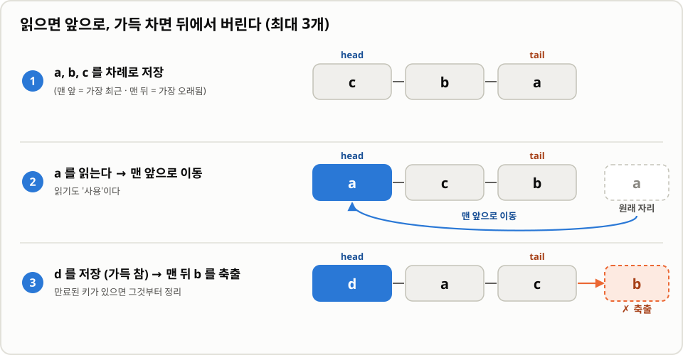
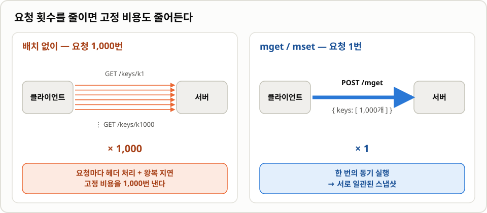
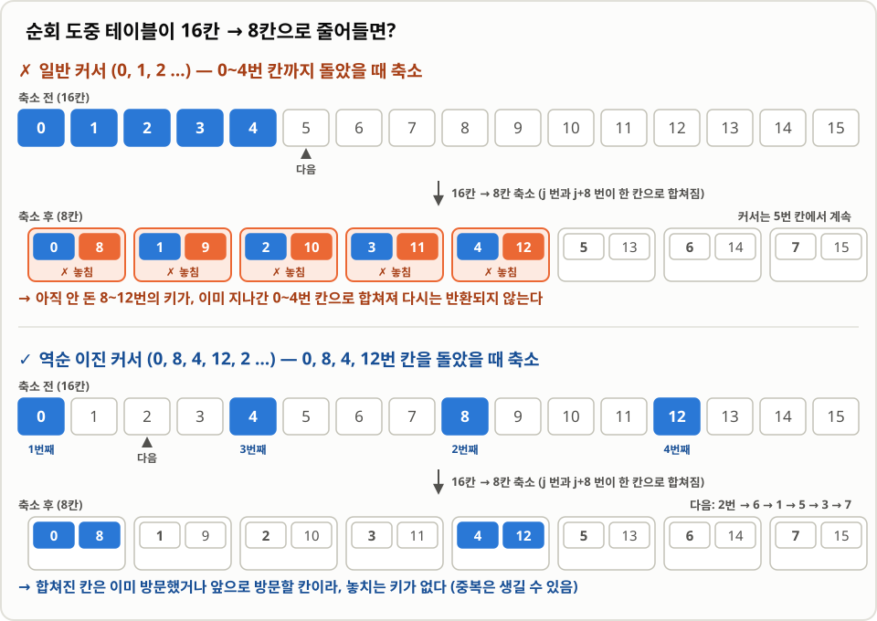
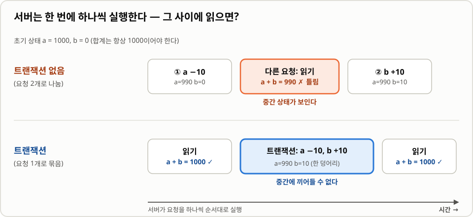

# Mini Redis — 추가 기능 4가지

> AI와 함께 구현했고, 헷갈린 부분은 직접 질문하며 이해했습니다.

| 기능 | 한 줄 |
|---|---|
| [1. LRU 축출](#1-lru-축출) | 가득 차면 가장 오래 안 쓴 키부터 버린다 |
| [2. 배치](#2-배치-mget--mset) | 요청 1,000번을 1번으로 |
| [3. SCAN](#3-scan) | 서버를 멈추지 않고 키를 순회한다 |
| [4. 트랜잭션](#4-트랜잭션) | 여러 명령을 끼어들기 없이 실행한다 |

---

## 1. LRU 축출

- **처음 든 의문** — "로그를 압축해도 꽉 차면?" → 압축은 과거 기록만 줄일 뿐, 살아 있는 데이터는 못 줄인다.
- **없으면** — 상한이 없으면 메모리가 늘어 서버가 죽고, 상한만 있으면 가득 찬 뒤 새 키를 전부 거부한다.
- **해결** — 해시 테이블(키로 찾기)과 이중 연결 리스트(사용 순서)를 함께 쓴다. 접근하면 맨 앞으로, 가득 차면 만료 키부터 정리하고 그래도 가득이면 맨 뒤를 버린다. 전부 O(1). 버려도 되는 이유: **원본은 DB**라서 못 찾으면 다시 가져오면 된다.
- **증거** — 무작위 연산 2만 번을 `Map` 정답과 비교해도 항상 일치.
- **한계** — 키 **개수** 기준(바이트 크기 무시), 읽기 순서는 AOF에 남지 않음.

켜는 법: `EVICTION=lru MAX_KEYS=1000`

---

## 2. 배치 (`mget` / `mset`)

- **비유** — 마트에서 물건 1,000개를 사러 1,000번 왕복하는 대신, 장바구니 하나에 담아 한 번에.
- **없으면** — 키 1,000개에 요청 1,000번 → 고정 비용을 1,000번 냄. 따로 읽는 사이 값이 바뀌고, 쓰다 실패하면 일부만 저장된다.
- **해결** — 한 요청에 담아 한 번의 동기 실행으로 처리. `mget`은 일관된 스냅샷, `mset`은 전부 검증 → 공간 확인 → 한 번에 반영(**전부 저장 or 전부 거부**).
- **증거** — 키 1,000개 기준 (같은 PC에서 측정)

  | | 하나씩 | 배치 한 번 |
  |---|---|---|
  | 읽기 | 76 ms | **2.3 ms** (약 33배) |
  | 쓰기 | 111 ms | **2.2 ms** (약 50배) |

- **한계** — 한 번에 최대 1,000개 (단일 스레드라 크게 하면 다른 요청이 기다림).

---

## 3. SCAN

- **처음 든 의문** — "나눠 돌아도 시간은 줄지 않는데?" → 맞다. 목적은 시간 단축이 아니라 **서버를 멈추지 않는 것**. "비트 뒤집기는 그냥 짝수·홀수 아닌가?" → 아래 해결 참고.
- **없으면** — `GET /keys`는 전체를 한 번에 훑는 O(n)이라 키가 많으면 서버가 멈춘다. 커서를 0, 1, 2…로 올리면 리사이즈 때 키를 놓친다 (그림).
- **해결** — 커서의 **비트를 뒤집어서** 올린다 (`0, 8, 4, 12, 2, …`). 축소 때 한 칸으로 **합쳐질 짝꿍**(`0↔8`, `4↔12`)이 연달아 방문되어 리사이즈가 끼어도 놓치지 않는다. `GET /scan?cursor=0&count=100` → 돌려받은 cursor가 `0`이면 끝.
- **증거** — 순회 도중 테이블을 키우고 줄여도 처음부터 있던 키를 하나도 놓치지 않는 테스트.
- **한계** — 리사이즈가 끼면 같은 키가 **두 번** 나올 수 있다. `count`는 반환 개수가 아니라 검사 개수.

---

## 4. 트랜잭션

- **처음 든 의문** — "갑자기 이체가 왜 나오지?" → 은행 앱이 아니라, 명령 두 개를 **한 덩어리로 묶어야 하는 상황**의 대표 예시.
- **없으면** — 이체를 요청 2개로 나누면 그 사이에 다른 요청이 중간 상태(합계 990)를 본다.
- **해결** — 명령 여러 개를 한 요청에 담아 끼어들기 없이 연달아 실행한다 (명령이 동기라 락 불필요). 형식 오류는 **전부 거부**, 실행 중 오류는 **롤백 없이** 그 명령만 실패, AOF에는 **한 줄**로 기록해 크래시 시 통째로 복구 or 폐기.
- **증거** — 읽기 300번 중 합계가 틀리게 보인 횟수: 요청 2개로 나눔 **160번** → 트랜잭션 **0번** (같은 PC, 실행마다 다름)
- **한계** — 롤백과 `WATCH`(낙관적 락)가 없다. "읽고 → 판단하고 → 쓰기"는 `incr`·`SET NX` 같은 단일 명령으로.

---

세 기능(배치 · SCAN · 트랜잭션)은 모두 **"명령이 동기 함수라서 끼어들기가 없다"** 는 같은 원리 위에 있고, 락은 하나도 추가하지 않았다.
자세한 설명: [core-features.md](./core-features.md) · [batch-scan-transaction.md](./batch-scan-transaction.md)
